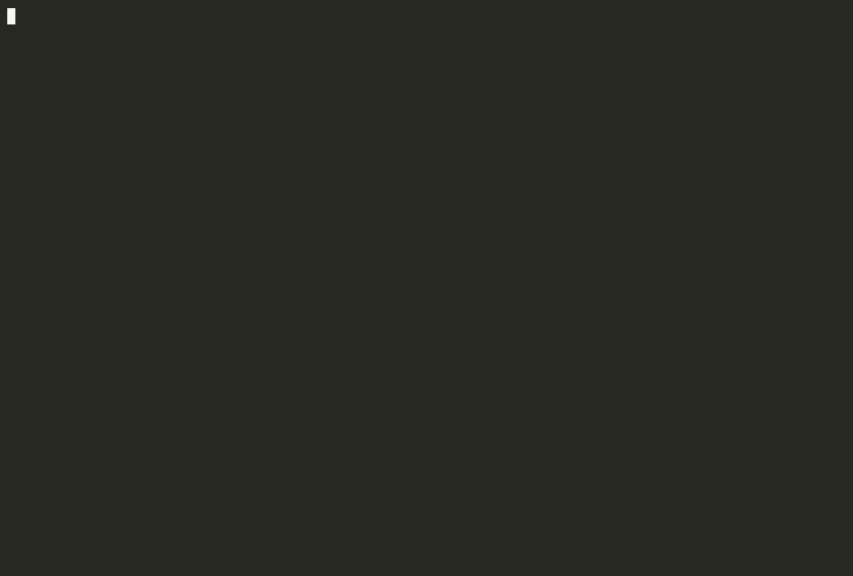

# Cleat

**Know what your skills reach for. Notice when it moves.**



<sub>A real scan of the test fixture in this repo (`test/fixtures/remote-loader-skill`), run offline so nothing is fetched. Every host in the fixture is fake.</sub>

Cleat is an open-source agent skill scanner: a skill for coding agents
(Claude Code, Codex, Cursor and anything else that reads `SKILL.md`). Point it at another skill and it
will:

1. **List everything that skill reaches for**: URLs, downloads, package
   installs, including ones hidden in comments, base64 or invisible Unicode.
2. **Look at what is there today**, using a read-only fetcher built for
   hostile links, and check it for red flags.
3. **Lock it**: record a fingerprint of every outside source.
4. **Verify later**: tell you when any of it has changed, even though the
   skill's own files have not.

It needs Node 18 or newer and nothing else. No packages, no account, no API
key. Nothing about your skills leaves your machine except the requests to the
links the skill itself contains.

## Why

In February 2026 a malicious skill on a public marketplace was downloaded
7,743 times before it was removed. When a renamed copy appeared, its
`SKILL.md` contained no malicious code at all: it sent the agent to a paste
site and a download for the payload. The malicious part lived somewhere else,
where a scanner reading the skill never looked and where it could be replaced
at any time ([Snyk](https://snyk.io/articles/clawdhub-malicious-campaign-ai-agent-skills/),
[Unit 42](https://unit42.paloaltonetworks.com/openclaw-ai-supply-chain-risk/)).

Hash pinning does not help here. The skill file's hash is unchanged, the
lockfile is green, and the behaviour is different because the content at the
other end of a URL changed.

OWASP calls this [AST05: Untrusted External Instructions](https://owasp.github.io/www-project-agentic-skills-top-10/ast05.html)
and recommends recording a content hash for every external document a skill
references and re-verifying it. Cleat does that.

## Research

We ran Cleat over 355 of the most-installed agent skills and verified its
labels by reading random samples. At least 36% of the skills explicitly tell the agent to read,
download or run outside content, and only 13 of 4,273 outside links are pinned
to a fixed version, all in one skill. The full report is on Zenodo:
[doi.org/10.5281/zenodo.24209170](https://doi.org/10.5281/zenodo.24209170).
The method, repository list and per-skill notes are in
[`research/2026-11-survey.md`](research/2026-11-survey.md).

## Install

New to this? The [getting started guide](docs/getting-started.md) walks
through checking a skill before you install it, step by step.
[See it in six screens](docs/screenshots/README.md): install, scan, lock,
verify, and catching a change.


```bash
npx skills add https://github.com/baulintech/cleat --skill cleat
```

The installer asks which agents to install to. To run it unattended (in docs
or CI), name the agent and skip the prompts:

```bash
npx skills add https://github.com/baulintech/cleat --skill cleat -a claude-code -y
```

Or copy the `skills/cleat` folder into your agent's skills directory.

## Use it through your agent

> Check the skill in ./downloads/some-skill before I install it.

> Lock the external references of every skill in .claude/skills.

> Have any of my installed skills drifted since I locked them?

The agent runs the script, reads the result, and explains it in plain
English.

## Use it directly

```bash
node skills/cleat/scripts/cleat.mjs scan   path/to/skill
node skills/cleat/scripts/cleat.mjs lock   path/to/skill
node skills/cleat/scripts/cleat.mjs verify path/to/skill
```

Add `--json` for machine-readable output and `--offline` to skip fetching.
Point Cleat at a folder that contains `SKILL.md`; anything else is refused, and
a mistyped option stops the run rather than being ignored.
Locks are kept in a `.cleat` folder. Cleat uses the nearest one above the
skill, so `lock` and `verify` agree wherever you run them from; if there is
none, it uses `.cleat` in the current folder. Pass `--state-dir` to choose.
Each lock belongs to one skill folder, so skills that share a name never
overwrite each other's baseline.

Every link the agent is told to read, download or run is fetched, riskiest
first, up to a safety limit of 500 per run (`--max-fetch`). Plain mentions are
capped at 40 (`--max-mentions`). If a skill is so large that the safety limit
leaves acted-on links unfetched, `lock` refuses to save an incomplete baseline
unless you pass `--allow-partial`.
`scan` exits 1 when it finds anything at high severity or above. `verify`
exits 1 on drift at medium or above, so it can gate a CI job:

```yaml
- run: node skills/cleat/scripts/cleat.mjs verify .claude/skills/some-skill
```

Try it on the bundled test skill, which imitates the attack described above
with fake hosts:

```bash
node skills/cleat/scripts/cleat.mjs scan test/fixtures/remote-loader-skill --offline
```

## What a report looks like

```
Cleat report for skill "fastcache-optimizer"

Verdict: HIGH RISK. Do not install or run this skill until a person has reviewed the items below.

Outside links: 6  (run as code: 2, downloaded: 2, agent told to read: 2, plain mentions: 0)
Packages installed or run: 1
References hidden from a normal read: 2

[CRITICAL] EXECUTE  https://glot.io/snippets/cleat-fixture-not-real/raw
      found in: SKILL.md:19
      - Hosted on a paste or snippet site, where anyone can post and the content can be swapped at any time.
      - The skill runs this content as code.

[CRITICAL] EXECUTE  https://cdn.fastcache.example/boot.sh
      found in: SKILL.md:29 (hidden in base64)
      ...
```

And after something moves:

```
DRIFT DETECTED. 2 change(s) need review before you keep using this skill.

[CRITICAL] remote-changed  url:https://get.vendor.example/install.sh
      - The content behind this link has changed since it was locked. New red flags: pipe-to-shell. 1 line(s) added, 1 removed.
```

## How it stays safe

The links inside a skill under review are chosen by a possible attacker, so
the fetcher is deliberately strict:

- `http` and `https` only, `GET` only, no cookies
- private, loopback, link-local and cloud metadata addresses are refused, and
  the check happens on the address actually connected to, so DNS tricks do not
  get round it
- redirects are followed by hand and re-checked at every hop
- size and time caps, nothing decompressed, nothing executed
- text quoted in reports is trimmed, cleaned and labelled untrusted, and the
  skill tells the agent never to act on it

Details are in [`threat-model.md`](skills/cleat/references/threat-model.md).

## What it does not do

- It does not run the skill, so run-time behaviour is out of scope.
- A server can show a scanner one thing and an agent another. A clean result
  means nothing was found from where Cleat stood.
- Its red-flag rules catch well-known shapes, not every possible attack.
- It records onward links in fetched pages but does not follow them yet.

Cleat complements skill scanners and sandboxes. It does not replace them.

## Cleat flags itself

Run Cleat on its own folder and it reports high risk. Its rule file contains
the patterns it searches for, so they match. Other skill scanners may flag it
for the same reason. The source is short and has no dependencies, so the
quickest check is to read it.

## Why "Cleat"

A cleat is the fitting on a boat or dock that a rope is tied to, so it holds.
This tool ties a skill to what you reviewed, and tells you when anything it
depends on slips.

## Common questions

**How do I check if an AI agent skill is safe before installing it?**
Copy the skill's files into a scratch folder without running its setup, then
ask your agent to "use Cleat to check" that folder. Cleat lists every link,
download and package the skill depends on, including hidden ones, and flags
risky patterns. A clean result means nothing was found, not that the skill is
safe. The [getting started guide](docs/getting-started.md) has the steps.

**What is OWASP AST05?**
AST05, Untrusted External Instructions, is a risk in the
[OWASP Agentic Skills Top 10](https://owasp.github.io/www-project-agentic-skills-top-10/ast05.html):
a skill that tells the agent to read, download or run content hosted
somewhere else, which can change after the skill was reviewed. Cleat records
a fingerprint of that content and reports when it changes.

**How is this different from other skill scanners?**
Many scanners read only the skill's own files. Cleat also fetches what the skill's
links serve today, locks it, and tells you later if it moved, even when the
skill's files are unchanged.

**Which agents does it work with?**
Any agent that loads skills from a `SKILL.md` file, including Claude Code,
Codex and Cursor. It also runs on its own with Node.js 18 or newer, and in CI.

**Does it run the skill or send my files anywhere?**
No. Cleat only reads. Its only network requests go to the links in the skill,
read-only, through a fetcher that refuses private and local addresses.

**Is it free?**
Yes. Cleat is MIT licensed, with no account, API key or dependencies.

## Develop

```bash
node --test
```

The tests use a fake network and a local server, so they run offline.

Contributions are welcome. See [CONTRIBUTING.md](CONTRIBUTING.md) for where to start.

## Cite

GitHub's "Cite this repository" button gives a reference for Cleat. For the
survey, cite the report:
[doi.org/10.5281/zenodo.24209170](https://doi.org/10.5281/zenodo.24209170).

## Licence

MIT. Copyright 2026 Baulin Technologies Limited.

Maintained by Baffour Ampaw at [Baulin Technologies](https://baulin.co.uk).
Security issues: hello@baulin.co.uk. Please do not open a public issue for those.
